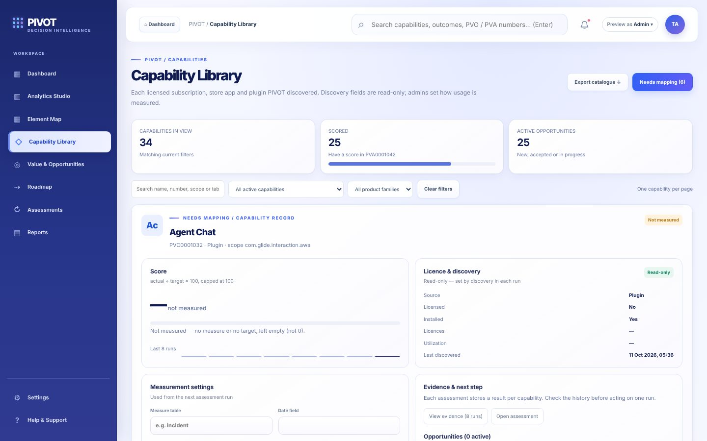
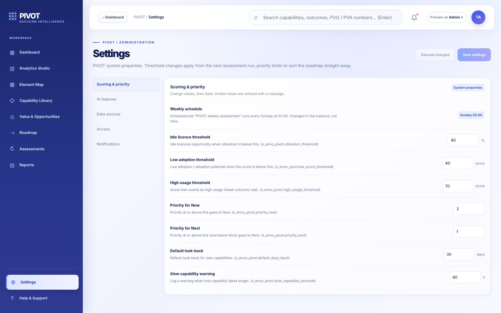
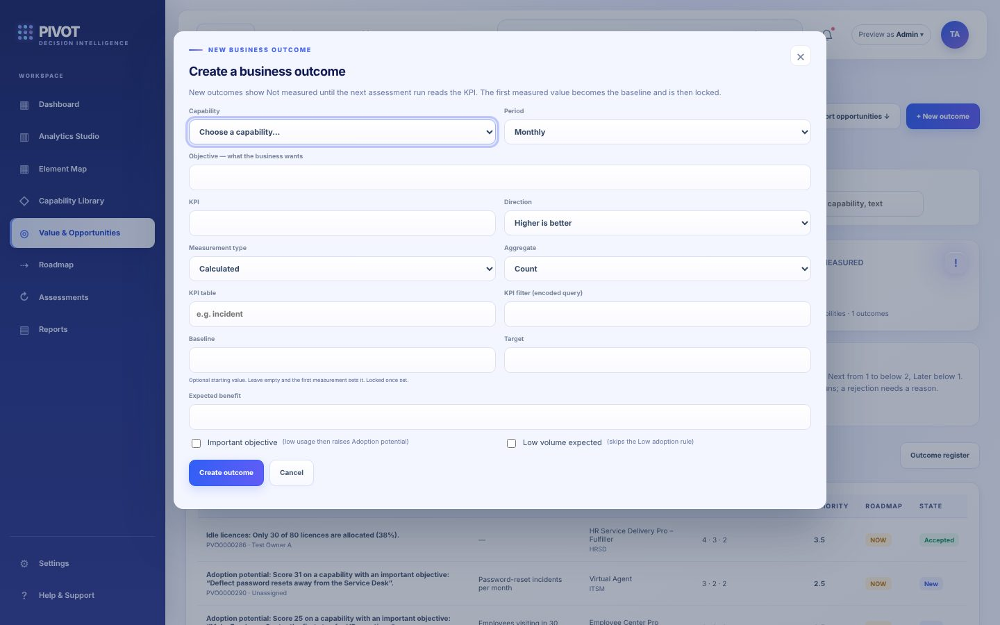
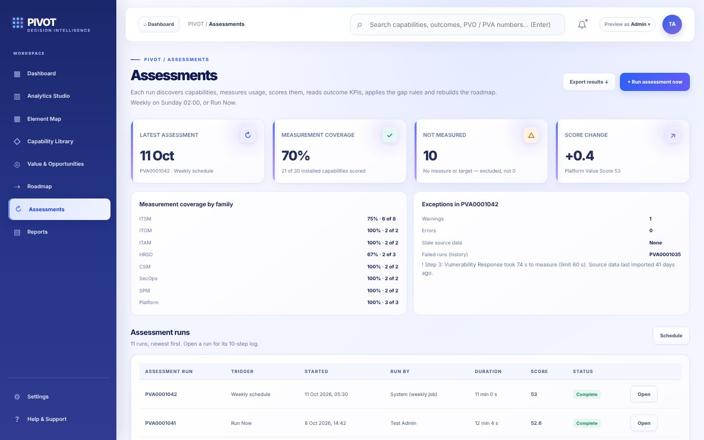
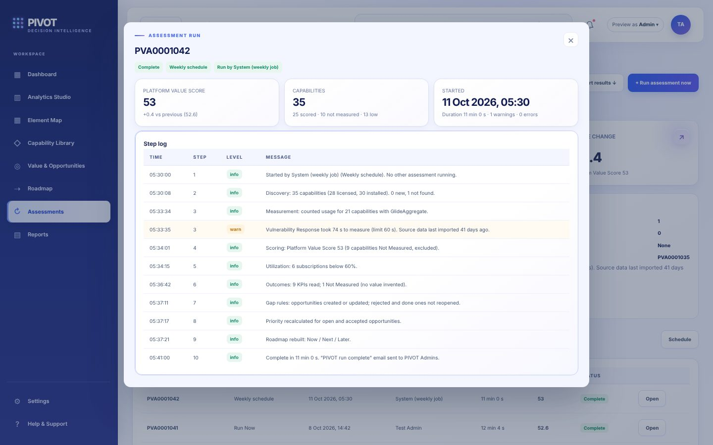

# Before you start

PIVOT only reads other applications' tables and writes to its own scope (x_enno_pivot). Admin work is done in the workspace (**PIVOT > Workspace**) and in the **PIVOT > Administration** modules: Capabilities, Needs mapping, Properties, Assessment list, Licences, Store apps, Plugins, Not found in last run, Opportunities, Gap no longer detected and Business Outcomes.

# Capabilities

## Where they come from

Each run starts with **discovery**: licences from the subscription overview (`sn_sub_man_st_subscription_overview`, fallback `license_details`), installed Store apps (`sys_store_app`) and plugins (`v_plugin`). For-fee items are filtered with `ua_app_family`, which also gives the product family. Each capability is keyed by source and source id, so a new run updates it instead of making a copy. Admin settings (family, weight, measure table, filter, target, days back, linked app) are never overwritten. Items no longer found are flagged "Not found in last run", never deleted. A licence counts as installed only when it is linked to an installed app capability (Linked app).

## Set the measurement (measure table, target, weight)

{width=100%}

1. Open **Capability Library** and page to the capability (or search for it).
2. In **Measurement settings** set:
    - **Measure table** – the table that shows real use, for example `incident`.
    - **Measure filter** – optional conditions, for example only active records.
    - **Date field** and **Days back** – the period counted (default `sys_created_on`, 30 days).
    - **Target** – the count that means full use (score 100).
    - **Weight** – how much the capability counts in the Platform Value Score (0 leaves it out).
3. Save. The next run measures it: score = actual ÷ target × 100, capped at 100. Without a measure table or target it stays **Not Measured**.

On first discovery 14 well-known products get a starting measure and target (for example Incident: `incident`, 30 days, target 500). They are starting points; change them to match your organisation. A cleared starter setting stays cleared.

## Map product families

Capabilities without a product family appear in **Needs mapping** (workspace notification and Dashboard row for admins). Open the capability and choose the family, or use the Needs mapping dialog. Families drive the Element Map columns, the family charts and the Reports family filter.

# Settings (system properties)

{width=100%}

Change them in the workspace under **Settings**. A value outside its range is refused with the reason. Every change is saved as the `x_enno_pivot.<name>` system property.

| Property | Shown as | Default | Valid values | Takes effect |
|---|---|---|---|---|
| utilization_threshold | Idle licence threshold (%) | 60 | whole number 0–100 | Gap rule at the next run; heatmap colours at once |
| low_score_threshold | Low adoption threshold (score) | 40 | whole number 0–100 | Bands and colours at once; gap rules at the next run |
| high_usage_threshold | High usage threshold (score) | 70 | whole number 0–100 | Bands and insights at once; weak outcome rule at the next run |
| priority_now | Priority for Now | 2 | number above "Priority for Next" | Workspace columns at once; the stored roadmap at the next run |
| priority_next | Priority for Next | 1 | number above 0 and below "Priority for Now" | As above |
| priority_weight_value | Priority weight: value | 1 | 0–10 | Priorities at the next run |
| priority_weight_impact | Priority weight: business impact | 1 | 0–10 | Priorities at the next run |
| default_days_back | Default look-back (days) | 30 | whole number 1–365 | New capabilities |
| slow_capability_seconds | Slow capability warning (s) | 60 | whole number 1–3600 | Next run |
| gap_rule_config | Gap rule texts and defaults (JSON) | empty (built-in defaults) | valid JSON per gap type: title, text, value, effort | New opportunities from the next run |
| admin_group | Run email recipients | PIVOT Admins | a group name, up to 100 characters (empty is refused) | Next run email: active members of this group also get it |
| ai_enabled | AI features (Now Assist) | true | on / off | At once (the AI features arrive with the AI release) |

Two more properties are set in **System Properties**, not in the workspace: `x_enno_pivot.max_run_minutes` (30; 0 = no limit; capabilities left when it is reached are Not Measured with "Run time limit reached") and `x_enno_pivot.timing_log` (false; true logs the time per capability).

# Business outcomes

{width=100%}

1. Open **Value & Opportunities > Outcome register > + New outcome** (or Administration > Business Outcomes).
2. Choose the **capability**, write the **objective** (what the business wants) and the **KPI**.
3. Choose **higher is better** or **lower is better**, the **target** and the **period**.
4. For a **calculated** KPI set the **KPI table** (for example `incident`), an optional **filter** and the aggregate: count, or sum / average of a field. For a **manual** KPI the owner enters the value and its date (not in the future); PIVOT warns when it is stale.
5. Tick **Important objective** if low use of this capability should raise an adoption potential opportunity, or **Low volume expected** if low use is normal.

**Baseline lock:** the first measured value becomes the baseline and is then locked, so the improvement stays honest. Only a PIVOT admin can change a locked baseline, and only with a reason; the old value, new value and reason are stored. Improvement = (actual − baseline) ÷ (target − baseline), direction-aware.

# Assessment runs

{width=100%}

## Schedule

The scheduled job **PIVOT weekly assessment** runs every **Sunday at 02:00** (instance time). To change the day or time, open System Definition > Scheduled Jobs, open the job and change Run / Day / Time. Only one assessment runs at a time; a run queued or running blocks the next one, and the weekly job skips with "PIVOT weekly run skipped: assessment already running".

## Run Now

Click **Run assessment now** on the Assessment list (PIVOT admins only), or **+ Run assessment now** in the workspace Assessments view. The run is queued and runs in the background; the list and the workspace show "step n of 10". A second click while one runs is refused with "An assessment is already running. Try again when it completes."

## Read the run log

{width=100%}

Open a run. The log has one line per step in order – discover, measure, score, outcomes, gaps, priority, roadmap, notify – each with its count and seconds, for example "gaps: 2 opportunities (18 updated, 0 gap(s) no longer detected) in 0.3 s". Warnings (slow capabilities, an outcome that could not be measured) mark the run **Completed with warnings**. When a step fails the run is **Failed**, the log names the step and the error, and the later steps do not run. A run left Queued or Running for more than twice the run time limit (at least 60 minutes) is set to Failed automatically.

## Run emails

When a run completes or fails, PIVOT emails every active user with the PIVOT admin role and the active members of the group in Run email recipients (`x_enno_pivot.admin_group`): subject "PIVOT run complete: PVA…, score N" or "PIVOT run failed: PVA…", with the status, score (or "Not available"), change, opportunities raised and updated, warnings, completion time, the error for a failed run, and an **Open in PIVOT** link to the run.

# Roles

Give roles in User Administration > Users (or to groups). Each PIVOT role contains the ones below it.

| Role | Contains | Give it to |
|---|---|---|
| x_enno_pivot.viewer | – | Anyone who reads PIVOT |
| x_enno_pivot.business_owner | viewer | Owners of business outcomes |
| x_enno_pivot.analyst | viewer | People who work opportunities and the roadmap |
| x_enno_pivot.admin | analyst, viewer | PIVOT admins (settings, capabilities, baselines, Run Now) |
| x_enno_pivot.security_tester | – | Security testers (security test logs and defects) |

`admin` does not contain `business_owner`; give both if an admin also owns outcomes. A PIVOT admin does not need the global admin role. Use the profile menu's **Preview as** to check what a role sees; it changes the screen only, never access.
