# What PIVOT tells you

PIVOT shows whether the ServiceNow products you pay for are used, and whether that use moves the business results they were bought for. Every Sunday at 02:00 (or when an admin clicks Run Now) PIVOT runs an **assessment**: it finds the products, counts how much each one is used, scores them, reads the business outcome KPIs, raises opportunities and rebuilds the roadmap.

Open PIVOT from the menu **PIVOT > Workspace**. Analysts also have **PIVOT > My Opportunities**.

## The words PIVOT uses

| Word | Meaning |
|---|---|
| Capability | One product PIVOT tracks: a licence, an installed Store app or a plugin. Numbers start with PVC. |
| Score (0–100) | Actual use ÷ target × 100, capped at 100. Example: 400 incidents in 30 days against a target of 500 = 80. |
| Not Measured | No measure table or no target yet. The capability has no score and is left out of the Platform Value Score – it is not counted as 0. |
| Licensed, not installed | Paid for but not installed. Scores 0 (shelfware). |
| Platform Value Score | The weighted average of all scored capabilities: Σ(score × weight) ÷ Σ(weight), one decimal. |
| Utilization | Allocated licences ÷ purchased licences. Above 100% means over-allocated. |
| Business outcome | A business goal for a capability with a KPI, baseline, target and owner. Status: Improved, On target, Below target or Not measured. |
| Opportunity | Something worth doing, raised by a gap rule (PVO number). |
| Assessment | One run of PIVOT (PVA number). |

## Usage bands

Every capability is in one band. The colours are the same in every view.

| Band | Rule (default thresholds) |
|---|---|
| Strong usage | Score at or above the high usage threshold (70) |
| Moderate usage | Score from the low score threshold (40) up to 69 |
| Low usage | Score below 40 |
| Licensed, not installed | Paid for but not installed |
| Not measured | No score yet |

## Who can do what

| Role | Can |
|---|---|
| Viewer | Read everything in the workspace. Every button that changes data is disabled with the reason. |
| Business owner | Viewer, plus create outcomes and keep their own outcomes up to date (manual values, the first baseline). |
| Analyst | Viewer, plus work opportunities (accept, start, reject with a reason, assign, close as done, change value, impact and effort) and reorder the roadmap. |
| Admin | Everything: capability settings, product family mapping, baselines, settings and Run Now. |

# The workspace

The left menu has ten views. The search box at the top finds capabilities, opportunities, outcomes and assessments by name, PVC / PVO / PVA number, scope, table or KPI – type and press Enter. The bell opens the notifications; the round button with your initials opens your profile menu.

## Dashboard

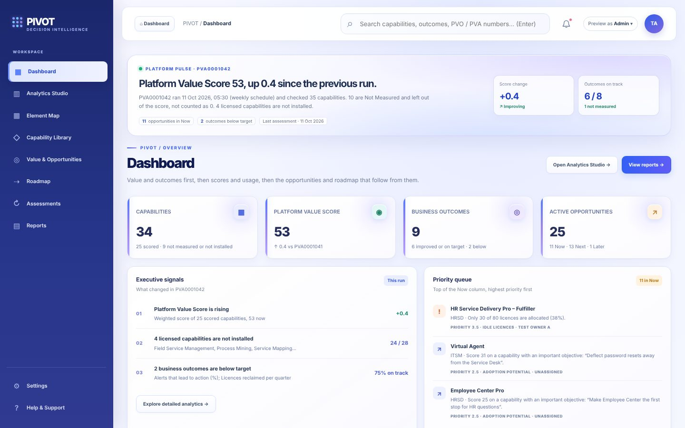{width=100%}

- **Top panel:** the latest run, its Platform Value Score and the change since the previous run ("unchanged", "up 0.4", "down 0.1"). The tags open the Roadmap (opportunities in Now), Value & Opportunities (outcomes below target) or the run dialog (Last assessment).
- **Four tiles:** capabilities (scored and not), the Platform Value Score, business outcomes and active opportunities by roadmap column. Click a tile to open its view.
- **Executive signals:** the score trend, licensed capabilities not installed and outcomes below target. Each row opens its view.
- **Priority queue:** the three highest opportunities in Now. Click one to open it.
- **Needs attention:** insights, stale data, mapping gaps and outcomes without a value, five rows per page. A row opens the capability, outcome or mapping dialog.

## Analytics Studio

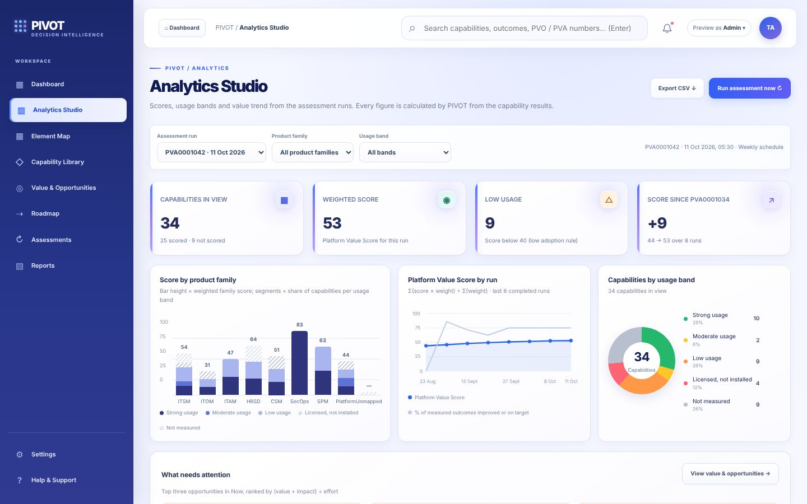{width=100%}

Choose a run, a product family and a usage band at the top; every tile and chart follows. With no filter the weighted score equals the run's Platform Value Score; with a filter it reads "For the filtered capabilities".

- **Score by product family:** bar height is the family score, the segments show the share of each band. Hover or tab to a bar to read its numbers.
- **Platform Value Score by run:** the solid line is the score per run, the dashed line the share of measured outcomes on track. It appears after the second run.
- **Capabilities by usage band:** click a band in the legend to filter by it; click again to clear.
- **What needs attention:** the top three opportunities in Now.

## Element Map

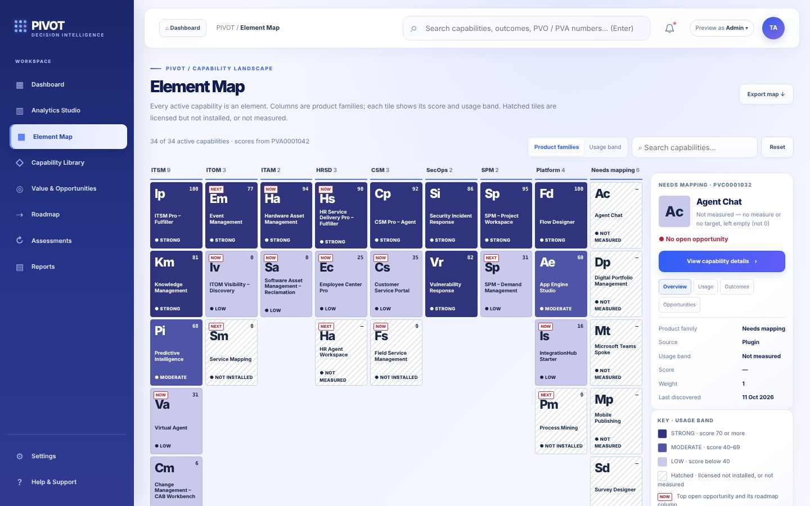{width=100%}

Every active capability is a tile, grouped by product family. The colour is the band; a tag shows the roadmap column of its top opportunity. Click a tile for its details; use search, grouping and reset at the top.

## Capability Library

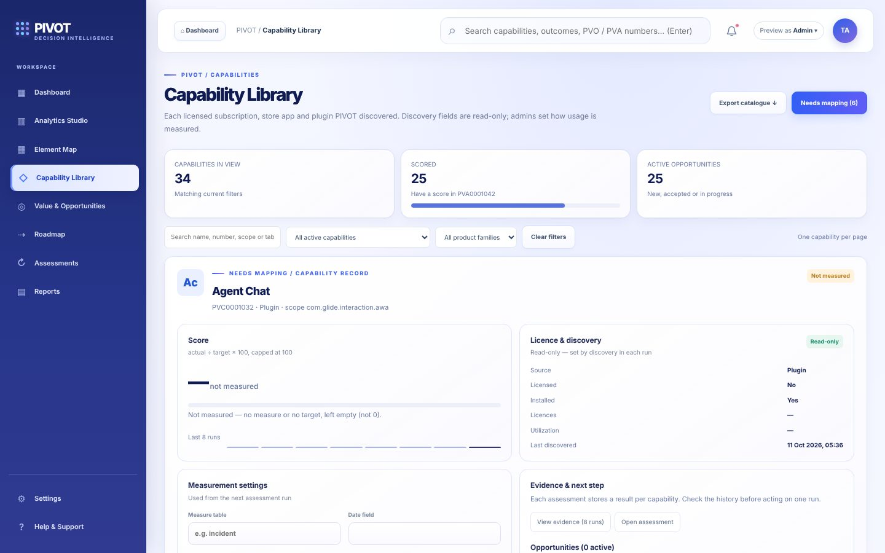{width=100%}

One capability per page with a pager. It shows the score, licence figures, measurement settings, the results of each run (evidence), its opportunities and its outcomes. Click an outcome to open it.

## Value & Opportunities

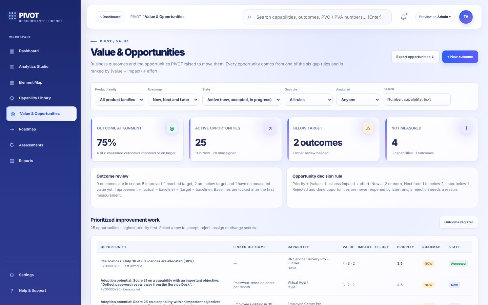{width=100%}

The prioritised opportunities table, the business outcome register and the decision panels. Click a row to open the opportunity or outcome dialog.

## Roadmap

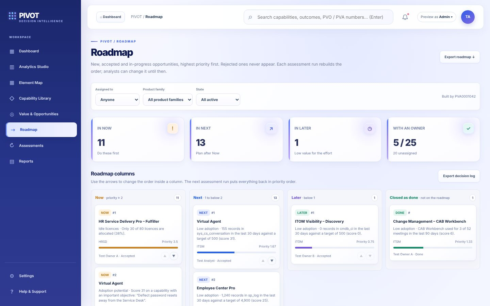{width=100%}

Columns **Now** (priority 2 or more), **Next** (1 to below 2), **Later** (below 1) and **Closed as done**. Rejected opportunities never appear. Each card shows its order, capability, gap type, family, priority (with a bar against the highest), owner and state. Five cards show per column; "Show 5 more" adds five.

## Assessments

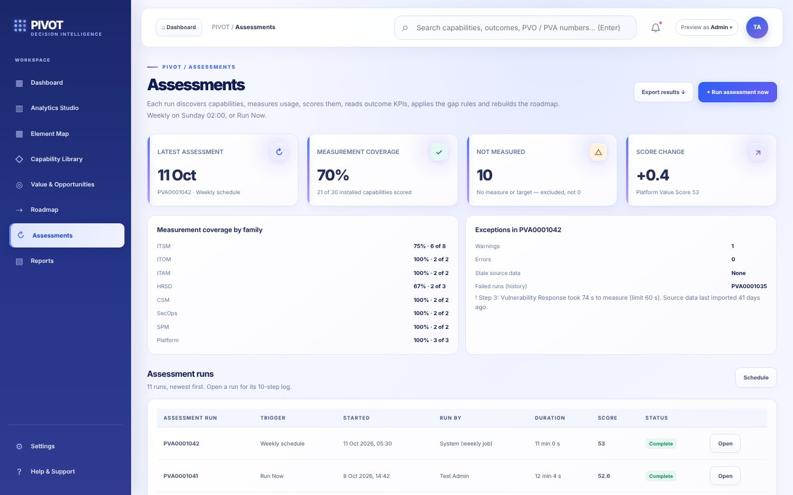{width=100%}

Coverage tiles, exceptions, the list of runs and the schedule. Click a run to open its dialog with the step log.

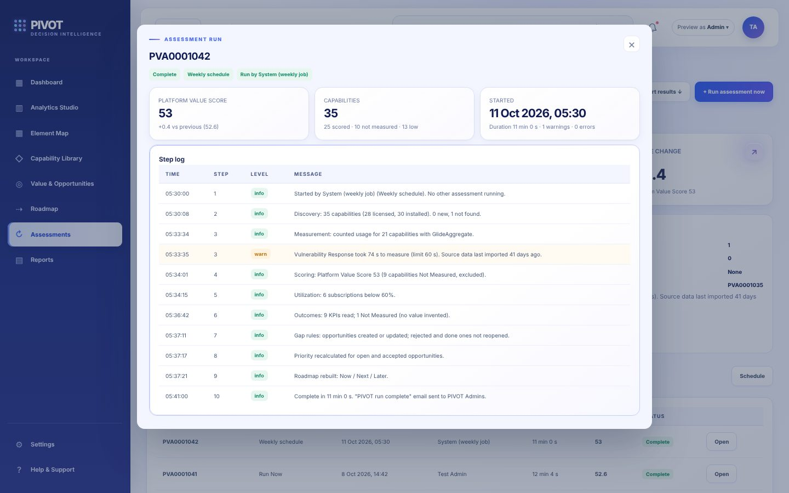{width=100%}

## Reports

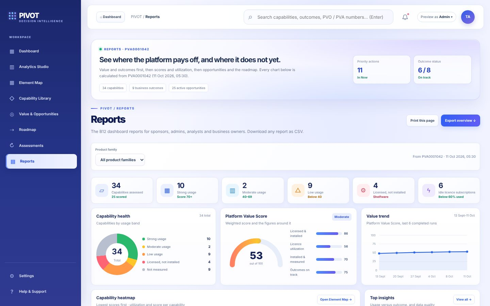{width=100%}

The latest run as a report: six summary cards, capability health, the value score gauge and trend, a heatmap (lowest scores first, five rows per page), insights, licensed vs installed, the top opportunities, the roadmap, portfolio charts and report cards with CSV downloads. Choose a product family to narrow every panel. "Print this page" prints every page of each list. Your downloads are listed under "Recently generated".

## Notifications and profile

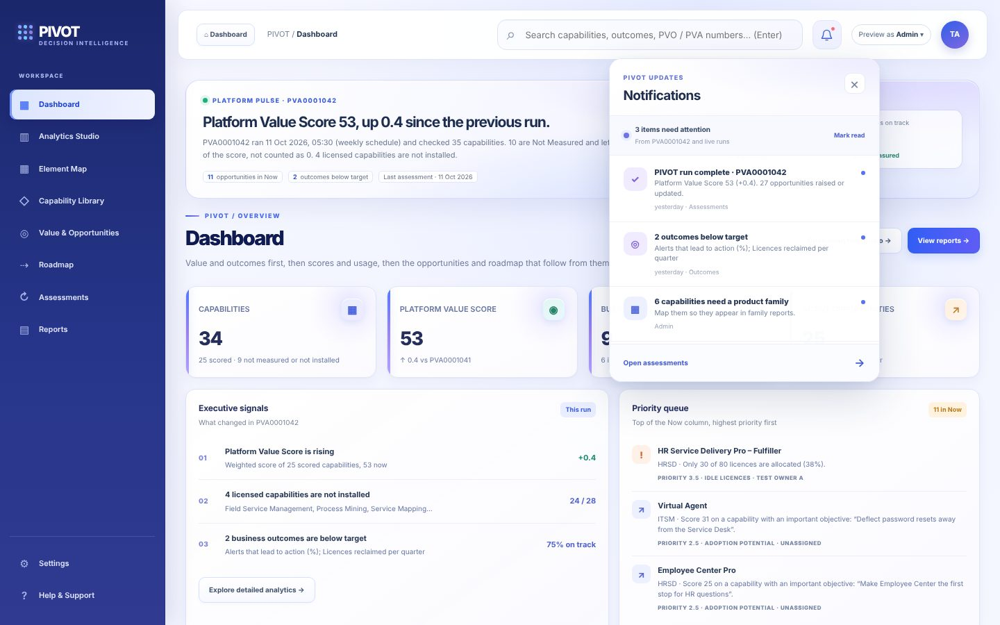{width=100%}

The bell lists the latest run, stale data, outcomes below target and (for admins) capabilities without a product family. A dot means unread; "Mark read" keeps them read next time.

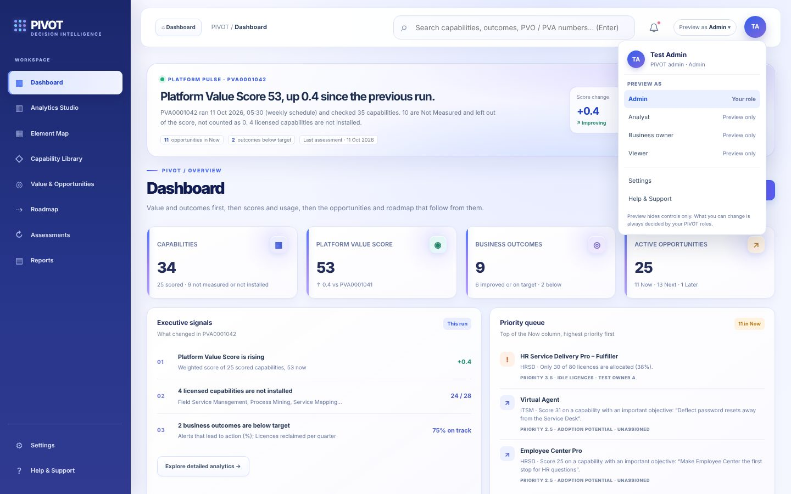{width=100%}

The profile menu shows your name, title and PIVOT role and links to Help & Support (and Settings for admins). Admins can "Preview as" another role to see what it sees; the server always uses your real roles.

# Working opportunities (analysts)

## Where opportunities come from

Each run applies six **gap rules** to every capability:

| Gap rule | Raised when | Default value / effort |
|---|---|---|
| Shelfware | Licensed but not installed | 4 / 3 |
| Idle licences | Utilization below the idle licence threshold (60%) | 4 / 2 |
| Low adoption | Score below the low score threshold (40), unless the outcome is marked "low volume expected" | 3 / 3 |
| Not measured | Licensed and installed, but no score | 2 / 1 |
| Weak outcome | Score at or above the high usage threshold (70) and an outcome below target | 4 / 3 |
| Adoption potential | Score below 40 and an outcome marked "important objective" | 4 / 3 |

A gap found again in the next run refreshes the same opportunity – it never duplicates. When a gap is no longer found, the opportunity is marked "Gap no longer detected". Rejected and Done opportunities are never reopened by a run.

## Priority and the roadmap column

**Priority = (value + business impact) ÷ effort.** Value and effort are 1–5, business impact 0–5. A run sets the business impact from the linked outcome: below target 3, on target 1, improved 0; analysts can change it. An empty business impact is not counted. The priority places the opportunity on the roadmap: **Now** at 2 or more, **Next** from 1 to below 2, **Later** below 1. Each run rebuilds the roadmap order by priority.

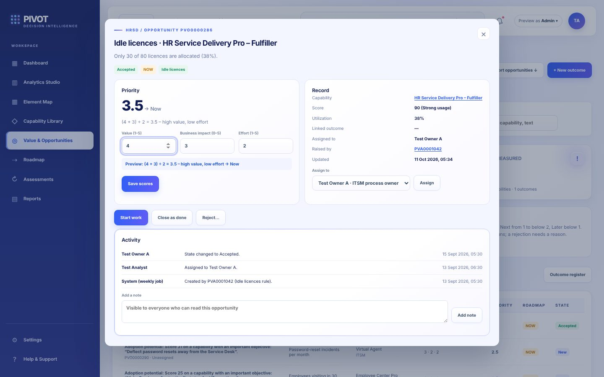{width=100%}

## Steps

1. Open **Value & Opportunities** (or **My Opportunities**) and click an opportunity.
2. **Accept** it to work on it, then **Start work** (In progress) and **Close as done** when finished. Done or Rejected can be **Reopened**.
3. To **reject**, click **Reject…**, write the reason and confirm. A rejection without a reason is refused, so later runs know why.
4. To change **value, business impact or effort**, type the new numbers. The **preview** shows the new priority and roadmap column before you save; click **Save scores**.
5. **Assign** it to a group and a person (only members of the group can be chosen). Add **notes** for everyone who can read it.
6. Every change is written to the activity log; Export decision log in the Roadmap downloads all of them.

On the Roadmap, analysts can move a card up or down with ▲ ▼ (only with no filters). The next run puts everything back in priority order; **Reset to priority order** does it at once.

# Business outcomes (business owners)

Open **Value & Opportunities > Outcome register** and click **+ New outcome**: choose the capability, write the objective and KPI, the direction (higher or lower is better), the target and how it is measured (calculated from a table, or a manual value with its date). You can set the first baseline; after that it is locked and only an admin can change it, with a reason.

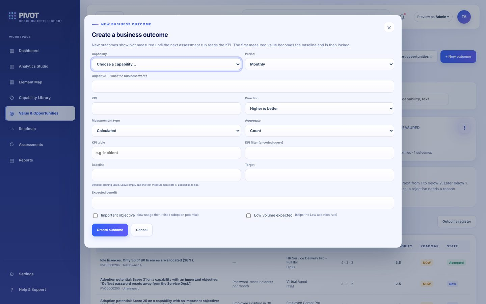{width=100%}

# Help

**Help & Support** has four start cards, the FAQ and **How scores work**, which lists every rule with the current limits.

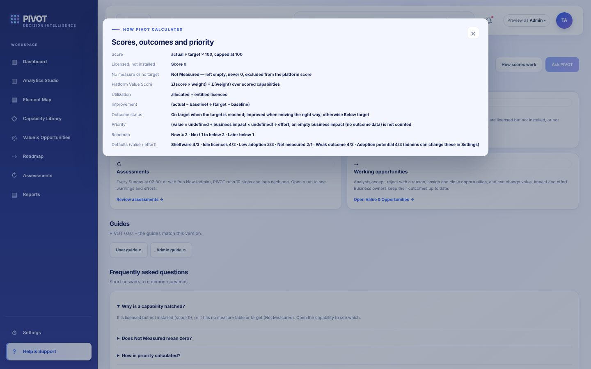{width=100%}
